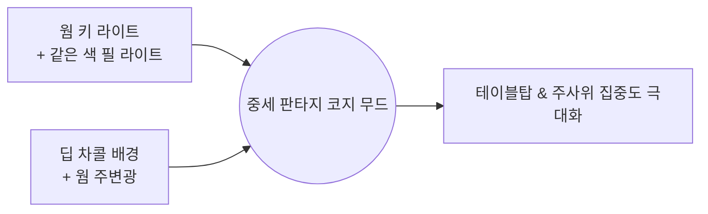

# Cozy Fantasy Hearth & Tabletop Art Style Guide

> **문서 종류**: 기준 문서 (사람 대상)
> **코드 대조 기준**: 2026-10-22 · 커밋 `f949af9`
> 이 문서는 위 시점의 코드에서 확인된 것만 기술합니다. 계획 항목은 상태 표기로 구분합니다.
> 작성 원칙은 [`docs/README.md`](../README.md)를 보십시오.

본 문서는 게임의 전체적인 비주얼 톤앤매너, 테이블 및 러너 디자인, 조명 설정을 차후 다른 AI 모델 및 작업자에게 일관되게 인수인계하기 위한 공식 아트 가이드입니다.

---

## 1. 핵심 분위기 & 라이팅 (Atmosphere & Lighting)

- **전체 무드**: 아늑하고 따뜻한 중세 판타지 학자의 서재 / 벽난로 선술집 (Cozy Fantasy Study & Hearth).
- **조명 리그**: `YachtLightingRig`(`Assets/02.Scripts/Games/Yacht/Presentation/Stage/YachtLightingRig.cs`)가 런타임에 Directional 키·필 라이트의 색과 강도를 프리셋 값으로 덮어쓴다. 씬에 직렬화된 라이트 값은 실효값이 아니므로, 조명 값의 원본은 이 파일의 `presets` 다.
  - **프리셋**: 기본은 `Soft Neutral`(`#ffe0bd`, 총 강도 1.35). 전환 순서로 `Warm Amber`(`#ff9e3b`, 1.50), `Pure White`, `Cool Moon`, `Cozy Candle` 이 있다.
  - **키/필 분배**: 총 강도의 75%를 키 라이트(pitch 60°, yaw -35°, Soft 그림자)가, 25%를 필 라이트(yaw 반대, 그림자 없음)가 쓴다. 필 라이트는 키와 **같은 색**이며 별도의 쿨 계열 림 라이트는 없다.
  - **색온도**: 쓰지 않는다(`useColorTemperature` 꺼짐). 색은 RGB로만 지정한다.
  - **주변광**: Flat `#291f17`.
- **촛불**: `CozyCandleStand` 의 Point 라이트 `#ff9933`, 기준 강도 1.35에 깜빡임을 더하고 범위 6.5. 프리셋 리그와 별개로 동작한다.
- **카메라 배경**: 월드 카메라 `#0f0b0a`, 프레젠테이션 카메라 `#0f0d12`(`YachtCameraRig.DarkCharcoalBackground`).
- **그림자 언더레이**: 테이블 틈새 아래 언더레이 머티리얼 `#140f0c`(`color-shadow-underlay`).

---

## 2. 테이블 디자인 (Tabletop Specification)

- **형태 (Geometry)**: 날카롭거나 얇은 면을 배제하고, 두께감 있고 모서리가 둥글려진 **두툼한 챔퍼(Chunky Beveled Edges)** 형태.
- **색감 (Wood Tone)**: 촛불과 모닥불 빛을 머금은 부드럽고 따뜻한 **웜 허니 브라운 / 토피 월넛 (`color-table-wood-main` `#6e432a`, `color-table-wood-tint` `#825033`)**. 판자 4장이 같은 램프를 쓰고, 판자별 차이는 결·옹이 패턴뿐이다.
- **표면 질감 (Texture & Shading)**:
  - 자잘한 실사 사진 노이즈를 배제한 **굵직한 스타일라이즈드 나뭇결**. 결·옹이·균열의 색 경계는
    보간하지 않고 계단으로 끊는다. 색은 §4의 `color-table-wood-main`·`color-table-wood-tint` 두
    토큰의 명암 램프 8색에서만 뽑아, 픽셀 필터의 팔레트 양자화 모드에서도 색이 튀지 않게 한다.
  - **텍셀 크기**: 판자 한 장(월드 38 × 4.9)에 텍스처 한 장을 `256 × 32`로 1:1 매핑한다. 텍셀이
    월드에서 거의 정방형(0.148 × 0.153)이 되어 저해상도 격자에서 두세 칸으로 읽힌다. 임포터는
    `Point` + 밉맵 off + 무압축이어야 한다. Baseline 연출은 1920×1080으로 렌더한 뒤 격자에
    스냅하므로, Bilinear나 밉맵이 켜지면 텍셀 경계가 번져 블록마다 중간색 줄이 생긴다.
  - 텍스처는 `Tools/Tessera/Generate Wood Plank Textures` 로 굽는다(`WoodPlankTextureGenerator`).
  - `Smoothness: 0.20` (자연스러운 무광 원목 질감), `Metallic: 0.0`.
  - 판자 머티리얼의 베이스 색은 **흰색**이다. 색은 텍스처가 통째로 들고 있으므로 곱하면 이중 착색이 된다.

---

## 3. 러너 디자인 (Runner & Accent Trim)

- **원단 베이스 (Fabric Body)**:
  - 차가운 원색 빨강이 아닌, 따뜻하고 묵직한 **딥 크림슨 / 테라코타 버건디 (`color-runner-crimson` `#882d22`)**.
  - `Smoothness: 0.12` (매트한 두터운 직물감), `Metallic: 0.0`.
- **골드 패턴 액센트 (Gold Trim & Pattern)**:
  - 러너 중앙 및 테두리에 **골든 옐로우 / 앤틱 머스터드 골드 (`color-runner-gold` `#e5a93c`)** 톤의 **기하학적 켈틱 놋워크(Celtic Knotwork) / 노르딕 패턴** 적용.
  - `Smoothness: 0.78`, `Metallic: 0.88` (은은하게 빛을 반사하는 메탈릭 골드).
- 러너와 트림 값은 `TabletopSurfaceBuilder` 가 머티리얼을 만들 때 쓰는 값이다.

> **Cel 모드 단서 (M16).** 위 `Smoothness`/`Metallic` 값은 `RenderStyle.Baseline` 기준이다.
> `RenderStyle.Cel`에서는 스페큘러와 환경 반사를 쓰지 않으므로 두 값이 화면에 나타나지 않는다.
> Cel에서 재질을 구분하는 것은 §4 명도 램프의 **밴드 수**다. 확산 재질은 3단, 금속으로 읽히길
> 원하는 재질(금색 트림 등)은 4단을 준다. 밴드 수는 별도 필드가 아니라 기존 `Metallic > 0.5`에서
> 파생시키므로, 위 값은 Cel 모드에서도 계속 의미를 갖는다. 자세한 내용은
> [`docs/reference/art/cel_shading_pixel_plan.md`](art/cel_shading_pixel_plan.md) 3절에 있다.

---

## 4. 디자인 시스템 컬러 팔레트 (Design Tokens)

`TesseraPixelPalette`(`Assets/02.Scripts/Rendering/TesseraPixelPalette.cs`)가 코드로 가진 토큰이며, 픽셀 필터의 팔레트 양자화와 목재 램프의 기준색으로 쓰인다. 조명·카메라 토큰 세 개는 실제 라이트·카메라 값과 다르다. 실효값은 §1을 본다.

| 토큰 명칭 | Hex Code | RGB (0~255) | 적용 대상 및 역할 |
| :--- | :--- | :--- | :--- |
| `color-light-warm-key` | `#ff9e3b` | `(255, 158, 59)` | 웜 앰버 팔레트 색. `Warm Amber` 조명 프리셋과 같음 |
| `color-light-cool-rim` | `#364b6e` | `(54, 75, 110)` | 쿨 인디고 팔레트 색. 대응하는 조명은 없음 |
| `color-table-wood-main` | `#6e432a` | `(110, 67, 42)` | 메인 원목 판자 테이블 색상 |
| `color-table-wood-tint` | `#825033` | `(130, 80, 51)` | 하이라이트/톤 변화 판자 색상 |
| `color-runner-crimson` | `#882d22` | `(136, 45, 34)` | 러너 패브릭 딥 크림슨 본체 |
| `color-runner-gold` | `#e5a93c` | `(229, 169, 60)` | 러너 골드 켈틱 트림/패턴 |
| `color-shadow-underlay` | `#140f0c` | `(20, 15, 12)` | 테이블 틈새 및 깊은 음영 언더레이어 |
| `color-scene-background` | `#0f0c10` | `(15, 12, 16)` | 딥 챠콜 팔레트 색. 카메라 배경은 §1 값을 씀 |

---

## 5. AI 모델 인수인계 지침 (AI Instructions)

차후 본 프로젝트의 비주얼, 씬 구성, 셰이더, UI를 작업하는 모든 AI는 다음 규칙을 준수해야 합니다:

1. **포토릴리스틱 노이즈 금지**: 실사 텍스처 노이즈나 복잡한 사인파 굴곡을 사용하지 말고, 단정하고 스타일라이즈드된 면과 색감으로 구현할 것.
2. **조명은 리그에서 조정**: 조명 색·강도는 `YachtLightingRig` 의 프리셋에서 바꿀 것. 씬의 라이트 값은 런타임에 덮어써지므로 씬에서 고쳐도 반영되지 않는다.
3. **일관된 컬러 토큰 사용**: 테이블과 러너 작업 시 본 문서의 4번 팔레트 토큰을 기본값으로 참조할 것.

---

## 6. 외부 에셋 출처

프로젝트 대부분의 3D 프롭은 에디터 제너레이터가 절차적으로 만들지만, 일부는 외부에서 가져온
모델입니다. 개별 모델 파일은 `Assets/04.Art/Source/<도메인>/`에 둡니다. 다만 에셋 스토어 패키지처럼
자체 폴더 구조를 갖고 들어오는 것은 `Assets/04.Art/ThirdParty/`에 임포트된 폴더를 그대로 두므로,
경로가 이 규칙을 따르지 않습니다.

| 에셋 | 출처 | 라이선스 |
|---|---|---|
| `quill_pen_low.fbx` | 제3자 로우폴리 깃펜 모델 (`free-quill-pen-lowpoly`) | **미기록.** 내려받은 패키지에 라이선스 파일이 없었습니다. 배포 전에 출처와 이용 조건을 확인해 여기 적어야 합니다 |
| `normal_dice.fbx` | 자체 제작 (`normal_dice.blend`) | 자체 |
| `yacht-tray.stl` → `yacht-tray.asset` | 자체 제작 | 자체 |
| `Assets/04.Art/ThirdParty/msVFX_Free Smoke Effects Pack/` | 제3자 연기 VFX 팩 (`Materials/msVFX_Stylized Smoke 1_Material.mat`, `Prefabs/msVFX_Stylized Smoke 1~4.prefab`, `Textures/msVFX_Stylized Smoke 1_Texture.png`) | **미기록.** 팩 폴더 안에 라이선스·README 파일이 하나도 없습니다. 배포 전에 출처와 이용 조건을 확인해 여기 적어야 합니다 |
| `Assets/04.Art/Source/Coin/coin.glb` | **반입 예정(`M17-T23`).** 제3자 동전 3D 모델 (`gold-coin.zip`에서 풀린 Blender glTF 2.0 파일) | 미기록 |
| `Assets/04.Art/Source/Coin/coin_head_source.png` | **반입 예정(`M17-T23`).** 사용자 제공 흉상 선화 | 미기록 |
| `Assets/04.Art/Source/Coin/coin_tail_source.png` | **반입 예정(`M17-T23`).** 사용자 제공 리라·월계관 선화 | 미기록 |

> **`quill_pen_low.fbx`의 라이선스 미기록은 배포 전에 반드시 해소해야 하는 항목입니다.**
> 이 경고는 원래 `Assets/Docs/README.md`에 있었고, 그 문서를 `docs/archive/plans/poc_technical_notes.md`로
> 옮기면서 여기로 이관했습니다.
>
> 깃펜 알베도 `quill_pen_albedo.png`는 원본의 베이스 컬러와 오퍼시티 맵을 합친 256×256 텍스처입니다.
> 원본 2048² 6장(11.2 MB) 대신 쓰고 있습니다.

> **`msVFX_Free Smoke Effects Pack`의 라이선스 미기록도 배포 전에 반드시 해소해야 하는 항목입니다.**
> `Assets/Resources/Vfx/DiceSmokeBurst.prefab`은 이 팩의 `msVFX_Stylized Smoke 2.prefab`을 소스로 삼은
> 프리팹 인스턴스이며, 머티리얼만 프로젝트 자체 제작한 `DiceSmokeBurst.mat`(자체 텍스처
> `DiceSmokeBurstTexture.png` 사용)으로 덮어써 씁니다. 파티클 모듈 파라미터(발사 속도, 크기, 색상
> 그라디언트 등)는 소스 프리팹의 오버라이드로 남아 있어, 팩 자체의 라이선스 조건이 이 파생물에도
> 그대로 적용됩니다.

> **`coin.glb`·`coin_head_source.png`·`coin_tail_source.png`는 아직 프로젝트에 반입되지 않았습니다.**
> `M17-T23`(코인 메시 반입과 앞뒷면 구분, 상세는 [`docs/plan/m17/T23-coin-mesh.md`](../plan/m17/T23-coin-mesh.md))의
> 산출물로 들어올 예정이며, 위 행은 실제 임포트 전 출처 기록입니다. 출처·라이선스는 사용자 확인이
> 필요한 열린 항목이고, 반입 시점에 이 경고와 라이선스 칸을 갱신합니다.

**임포트 주의**: `quill_pen_low.fbx`는 FBX 임포터의 `Use File Scale`을 **꺼야 합니다.** 켜면 0.01 배율이
적용돼 깃펜이 점 하나로 줄어듭니다.
